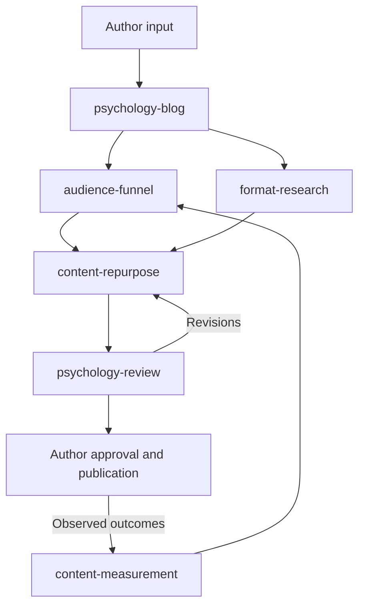

# Architecture

## One editorial workflow

The coordinator can invoke specialist instructions sequentially in one host agent. Separate subagents are an implementation option for research or independent review, not a requirement of the collection.

`author-context` maintains the shared record that all six workflow roles read.

## Shared data

The default working directory is `private/psychology-content/`. Its `context.md` is the shared source of author-approved identity, services, voice and boundaries. Audience evidence and hypotheses must retain their source and status.

A topic brief preserves the author's input and its intended meaning. A draft links to that brief, names its intended content job and labels external claims. Each substantive revision receives a new version. Author approval refers to that exact version and does not carry across later edits.

Keep reference observations, drafts and outcome records in the same private area. The public repository contains only reusable instructions and synthetic examples. Do not use a clinical record as a marketing database.

## Three content jobs

- **Discovery:** help the appropriate audience recognize a relevant question and meet the author's perspective.
- **Trust:** explain the author's reasoning, professional approach and the limits of the topic.
- **Inquiry:** make the actual service, suitability and way to ask about it clear.

These are editorial purposes. They do not establish a tracked funnel for every individual viewer. A reader can enter at any point, and a post can have a primary and secondary purpose.

## Evidence boundaries

Author statements are attributable to the author. Research findings require accessible sources. Audience hypotheses remain hypotheses until supported. Synthetic examples must be labeled. Inaccessible sources and missing statistics are not zeros.

Reference metadata can support observations about dates and displayed counts. A transcript supports observations about words and narrative. Visual production claims require video or frames. A popular example suggests a format to explore; it does not establish why the example succeeded or whether it generated clients.

## Tools

The host may provide transcription, web search, authorized video access, file storage or analytics. The skills request only capabilities available for the task. No keys, platform sessions, scraping services or subscriptions are bundled.

The initial workflow supports supplied references and manual outcome entry. A future adapter must document its permissions, data fields, access limitations, costs and failure modes, and be tested separately. It must not change the meaning of an observation to hide missing data.

## Decisions and completion

The author approves their stance, professional claims and publication version. The agent can suggest edits, investigate sources and identify contradictions. It cannot establish clinical correctness or consent on its own.

The coordinator stops after producing the requested usable package, with unresolved questions clearly separated. Internal review defaults to at most two revision rounds. Unsupported issues return to the author instead of triggering an unbounded loop.

Learning means preserving accepted edits and observed outcomes in the shared record. It does not imply model fine-tuning, automatic causal inference or permanent adoption of every generated suggestion.
